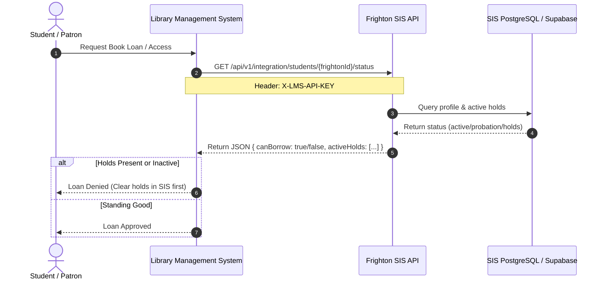

# Frighton University SIS & LMS Integration Specification

## 1. Executive Summary
This document specifies the integration protocol between the **Frighton University Student Information System (SIS)** and the **Frighton University Library Management System (LMS)**.

Both systems will share a common student/faculty identification schema (`frighton_id`, e.g., `STU-2026-0001` or `FAC-2026-0010`).

---

## 2. Shared Identity Architecture



---

## 3. Integration Endpoints

All requests must include the secret header:
```http
X-LMS-API-KEY: <LMS_INTEGRATION_API_KEY>
Content-Type: application/json
```

### 3.1. Query Student / Patron Status
- **Method**: `GET`
- **Route**: `/api/v1/integration/students/:frightonId/status`
- **Description**: Returns whether the patron is currently enrolled, active, and permitted to borrow library materials.

#### Example Response (200 OK)
```json
{
  "frightonId": "STU-2026-0042",
  "name": "Jane Doe",
  "email": "jane.doe@frighton.edu",
  "role": "student",
  "academicStatus": "active",
  "department": "Computer Science",
  "canBorrow": true,
  "activeHolds": []
}
```

---

### 3.2. Place Library Hold on Student Account
- **Method**: `POST`
- **Route**: `/api/v1/integration/holds`
- **Description**: Called by LMS when a student has overdue library items exceeding university limits or unpaid replacement fines. Placing a hold restricts registration or degree clearance in the SIS.

#### Request Body
```json
{
  "frightonId": "STU-2026-0042",
  "reason": "Overdue Rare Manuscripts (Grimoire Collection Vol. II)",
  "amount": 45.00
}
```

#### Example Response (201 Created)
```json
{
  "message": "Library hold successfully placed in SIS",
  "hold": {
    "id": "e4b6c374-...",
    "student_id": "9a12c842-...",
    "hold_type": "library_debt",
    "reason": "Overdue Rare Manuscripts (Grimoire Collection Vol. II) (Outstanding Balance: $45)",
    "placed_by_system": "Frighton LMS",
    "placed_at": "2026-10-08T16:00:00Z",
    "resolved_at": null
  }
}
```

---

### 3.3. Resolve Library Hold
- **Method**: `POST`
- **Route**: `/api/v1/integration/holds/:holdId/resolve`
- **Description**: Called automatically by LMS upon return of borrowed items or clearance of fines.

#### Example Response (200 OK)
```json
{
  "message": "Library hold successfully resolved in SIS",
  "hold": {
    "id": "e4b6c374-...",
    "resolved_at": "2026-10-08T16:15:00Z"
  }
}
```

---

## 4. Error Responses

| Status Code | Reason | Example Payload |
|:---|:---|:---|
| `401 Unauthorized` | Invalid or missing `X-LMS-API-KEY` header | `{"error": "Unauthorized: Invalid or missing integration API key"}` |
| `404 Not Found` | Unknown `frightonId` or invalid `holdId` | `{"error": "Entity with ID STU-9999-9999 not found in Frighton University SIS"}` |
| `500 Internal Error`| Database or server failure | `{"error": "Internal Server Error"}` |
