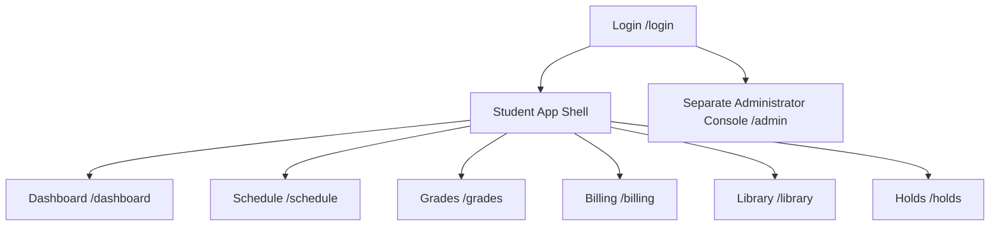

> Library v1 implementation update: the gateway, private LMS APIs, allocation, and debt synchronization are implemented but disabled by default. The Stage 1/Stage 2 descriptions below retain the original design sequence. Current release/configuration instructions: `library-self-service-operations.md`; current wire contract: `library-self-service.openapi.json`.

# Frighton University SIS - Page Architecture & Blueprint

## Scope and delivery status

Frighton SIS is a student self-service portal with a distinct administrator surface. The shared university `public.users` directory controls access; the SIS academic profile is `public.profiles`, keyed by `users_id` and identified externally by `student_number`.

- Only active `student` and `admin` directory accounts may sign in.
- The implemented dashboard endpoint is student-only: `GET /api/v1/dashboard/me`.
- The dashboard reads academic assignments from `academic_records`; this SIS does not model enrollment, registration, waitlists, section capacity, instructor accounts, or registrar accounts.
- The React client implements sign-in, session restoration, browser navigation, and a protected student shell. Dashboard, Schedule, Grades, and Billing are available student pages; Holds and the gated Library self-service page are implemented.
- SIS owns student identity, borrowing eligibility, and university holds. The Library Management System (LMS) owns its catalog, reservations, loans, due dates, and fines.
- The student browser calls SIS APIs only. SIS and LMS communicate server-to-server with separate credentials; LMS API keys and service-role capabilities never enter browser code.
- Dashboard, Schedule, Grades, Billing, and Holds have student-only read APIs. The Library feature gate controls access to its implemented LMS-backed features. The administrator surface remains separate.

## Route map

## Student dashboard

- **Route**: `/dashboard`
- **Access**: Student only.
- **Backend**: `GET /api/v1/dashboard/me`, protected by `requireAuth` and `requireStudent`.
- **Data returned**:
  - Digital ID: name, `studentNumber`, program, department, year level, academic status, and avatar.
  - Active academic term.
  - Metrics: current academic credits, cumulative GPA, earned credits, and active hold count.
  - Billing: current-term total billed, completed payments, outstanding balance, account status, and due date.
  - Unresolved student holds.
  - Current-term classes scheduled on the current `Asia/Manila` weekday.

The dashboard must render assignment language such as "current academic credits"; it must not imply that it can register a student for a class.

## Roadmap views

| Route | Audience | Backing system/tables | Notes |
| --- | --- | --- | --- |
| `/schedule` | Student | `academic_records`, `course_sections`, `courses`, `academic_terms` | Current assignment list, instructors, rooms, and published meetings are implemented. A weekly calendar is outside this baseline. |
| `/grades` | Student | `academic_records`, `course_sections`, `courses`, `academic_terms` | Static transcript, term/cumulative GPA, credit totals, and distinct grade statuses are implemented. |
| `/billing` | Student | `student_accounts`, `student_payments`, `academic_terms` | Current and historical statements, charges, and receipt ledgers are implemented with Manila timestamps and calendar due dates. No online payments. |
| `/library` | Student | LMS `books`, `reservations`, `borrow_records` | The default-off feature gate shows a pending screen; enabling it exposes catalog, reservations, current loans, due dates, and unpaid amounts. |
| `/holds` | Student | SIS `student_holds` | `GET /api/v1/holds/me` and the read-only account-restrictions page are implemented. Library restrictions use `hold_type = 'library_debt'`. |
| `/admin` | Admin | SIS portal tables | Separate console: dashboard, account management, full read-only student detail, and filtered/paginated audit history. |

## UI shell

The protected student shell exposes Dashboard, Schedule, Grades, Billing, Library, and Holds. The URL determines the active page, including direct links and back/forward navigation. Use the API's `studentNumber`. Administrators receive a separate console and full aggregate-backed student detail; students cannot enter admin routes. Sign-out remains available at mobile breakpoints. The unused notification control is hidden.

Concurrent expired safe reads share one refresh request and retry once. Account writes, email sends, and password submissions are never automatically replayed. Expired refresh credentials return to login; temporary Auth outages remain retryable without being presented as an empty session. The browser uses HTTP-only cookies and never stores Auth tokens in local/session storage.

## Library view intent

The Library page is a student self-service view of LMS-owned data. It is not a librarian console and it does not give the browser direct database or LMS access. When disabled, the Library renders an integration-pending page. When enabled, it uses real LMS data and student-scoped actions.

- The enabled Library shows a searchable catalog with availability and a Reserve action for available copies.
- A v1 reservation is a Main Library pickup reservation, not a waitlist. An active reservation is ready for pickup, expires after three days, and can be cancelled by the student before fulfilment.
- Show the student's active reservations, including book details, status, reservation date, Main Library pickup location, and expiry date.
- Show current loans with Manila-local due dates, overdue days, and read-only unpaid fines.
- Do not add renewals, loan history, student-entered payments, card/wallet forms, or librarian/staff workflows in v1.
- The LMS must allocate an available copy atomically, expire stale reservations, fulfil a reservation into a loan, and prevent duplicate active reservations for the same student and book.

## Holds view intent

The Holds page is a read-only account-restrictions view, not a library-loan or reservation page.

- Show active restrictions first, followed by resolved-hold history.
- For each hold, show its type, reason, source, placement date, status, and clearance guidance.
- A `library_debt` hold is an SIS restriction caused by library debt; it is not itself a book reservation or a loan record.
- Cross-link library-related guidance to `/library` and financial-hold guidance to `/billing` where appropriate.
- Students cannot create, edit, pay, or resolve holds from this page. Authorized SIS processes and the LMS manage hold state.

## Student APIs and LMS integration

Every student API requires `requireAuth` plus `requireStudent` and derives the student from the authenticated SIS session; the browser must never submit a student identifier or an LMS credential. The Holds endpoint is implemented in Stage 1. Library gateway APIs are implemented against the private LMS service contract and remain protected by the default-off feature gate.

| SIS API | Purpose |
| --- | --- |
| `GET /api/v1/library/books` | Return LMS-backed catalog search and availability data. |
| `GET /api/v1/library/me` | Return the signed-in student's active reservations, current loans, due dates, and read-only unpaid fines. |
| `POST /api/v1/library/reservations` | Request a reservation for an available LMS book using a server-derived student identity. |
| `DELETE /api/v1/library/reservations/:reservationId` | Cancel the signed-in student's eligible active reservation. |
| `GET /api/v1/holds/me` | **Implemented.** Return the signed-in student's active holds and resolved-hold history. |

SIS checks active status and unresolved SIS holds before forwarding a reservation request to LMS. LMS remains authoritative for availability, reservation state, loans, due dates, and fine amounts. If LMS is unavailable, SIS must not create or change a reservation locally.

SIS configuration includes an LMS base URL and a distinct SIS-to-LMS credential. The existing LMS-to-SIS integration credential remains inbound-only. Both credentials stay server-side and are never exposed to the student browser.

LMS continues to call the protected SIS integration endpoints to check a student's borrowing eligibility and synchronize library debt holds. Use `studentNumber` consistently in every new contract; `frighton_id` is legacy terminology and must not be reintroduced.

The implemented LMS contract creates or updates an idempotent SIS `library_debt` hold when a loan is 14 days overdue or an unpaid replacement charge exists. It must resolve that hold only when all qualifying library debt has been cleared; the synchronization upgrade requires the new migrations and a supervised maintenance worker before release.

## Billing view intent

The Billing page is a read-only statement center, not a payment gateway. The frontend should make the active-term statement prominent and use the returned `statements` as a newest-first term switcher or account history.

- Show total assessed, completed cashier payments, outstanding balance, due date, and `statementStatus` on the active-term card.
- Break charges into tuition, mandatory fees, and scholarship/discount. Show the receipt ledger with paid date, amount, reference number, and posting status.
- Display the supplied cashier and official-receipt notices near the ledger. A print action may create a reference statement, but must not label it an official receipt.
- Do not add a **Pay now** control, card/wallet forms, student-entered payments, or any payment write route. Only an authorized cashier/internal process records payments.
- If a future financial hold exists, cross-link it to `/holds`; do not infer or create a hold from a balance in the UI.

## Implementation order

The standalone student pages and administrator console are implemented for local demonstration. Automated client tests mock account/mail requests; database regression tests roll their synthetic writes back. Real invitation/recovery delivery and deployed configuration require the separate approved account-operations gate.

The integration implementation provides the directional credentials, private service contract, SIS Library gateway/UI, and idempotent debt synchronization. Live deployment remains gated by migration preflight, configuration, worker startup, and staging acceptance.

## Admin backend contract

All `/api/v1/admin` routes require an active authenticated directory administrator (`requireAuth` and `requireAdmin`). Student `/me` routes stay student-only. This release provides account lifecycle writes; academic records, schedules, holds, billing, courses, sections, and LMS records are read-only through the admin API.

| Method and route | Response / behavior |
| --- | --- |
| `GET /api/v1/admin/dashboard` | `metrics` (`totalStudents`, `activeStudents`, `inactiveStudents`, `probationStudents`, `studentsWithActiveHolds`), nullable `currentTerm`, and ten newest `recentActivity` audit events. Multiple holds on one student count once in the dashboard. |
| `GET /api/v1/admin/students` | `{ items, page, pageSize, total, totalPages }`. Filters: `q`, `accessStatus=active\|inactive`, `academicStatus`, `department`, `page`, `pageSize`. Literal case-insensitive substring search across name, email, and student number; department is an exact case-insensitive match. Ordering: case-insensitive last name, first name, then UUID. |
| `POST /api/v1/admin/students` | `201 { student }`. Requires `firstName`, `lastName`, `email`, `studentNumber`, `department`, `program`, `yearLevel`, `academicStatus`. Optional `middleName`, `avatarUrl`. Invites by email and provisions shared directory + SIS profile. |
| `GET /api/v1/admin/students/:studentId` | `{ student, dashboard, schedule, grades, holds, billing }`. `student.auth` contains nullable `invitedAt`, `emailConfirmedAt`, `lastSignInAt`, or is null when no Auth identity matches. Auth UUIDs and credentials are never returned. Domain sections use the existing student aggregation rules. |
| `PATCH /api/v1/admin/students/:studentId` | `200 { student }`. Editable fields: `firstName`, `middleName`, `lastName`, `email`, `department`, `program`, `yearLevel`, `academicStatus`, `avatarUrl`. Student number and role are immutable. |
| `POST /api/v1/admin/students/:studentId/deactivate` | `200 { student }`; changes only directory access state. |
| `POST /api/v1/admin/students/:studentId/reactivate` | `200 { student }`; restores directory access. Academic status remains independent. |
| `POST /api/v1/admin/students/:studentId/password-recovery` | `202 { message }` after Supabase accepts the recovery-email request and its audit event commits. |
| `POST /api/v1/admin/students/:studentId/invitation-resend` | `202 { message }` for an active, provisioned student with a pending invitation. Confirmed/non-invited/inactive accounts return `409`; missing or inconsistent Auth identity returns `503`. |
| `GET /api/v1/admin/audit-logs` | `{ items, page, pageSize, total, totalPages }`. Filters: `action`, `studentId`, `actorId`, `from`, `to`, `page`, `pageSize`. Date filters are inclusive ISO timestamps with a timezone. Order: timestamp descending, UUID descending. |

Student scope is a shared-directory student (`Students`/`student`, normalized case-insensitively) with a SIS `student` profile. Admin and librarian records are never student targets. Student snapshots include UUID, student number, name, email, academic-profile fields, `isActive`, and timestamps; student-list rows also contain `activeHoldCount`. A valid missing student UUID returns `404`; a malformed UUID returns `400`.

Pagination defaults to page 1 and 25 rows; page size is limited to 100. Invalid/repeated/unknown query parameters and unknown/immutable body fields return `400`. New student numbers must match `STU-YYYY-NNNN` or a longer numeric sequence (maximum 50 characters). Names and department are limited to 100 characters, program to 150, email to 254, search to 100, and avatar URL to 2048. Year level is 1–4. Optional profile fields can be cleared with null; whitespace-only optional text clears it. Creation requires a non-empty department/program and a year level. Email is trimmed and lowercased. Bodyless actions accept only an empty body/object.

### Identity synchronization and audit behavior

- `admin_write_student` commits directory/profile changes and their audit event together. Only the service role can execute admin RPCs; the database rechecks the actor's active directory-admin role.
- Auth identities are resolved by email, not by assuming `users.users_id` equals `auth.users.id`. A minimal service-only SQL lookup avoids exposing Auth secrets or enumerating the Auth directory through the API.
- Invitations use `CLIENT_URL` plus `/set-password`. The frontend password screen is implemented locally. Configure its exact deployed URL in the Auth redirect allowlist only through the approved rollout; API mail acceptance does not prove inbox delivery.
- Admins never supply passwords. The legacy required directory password column receives a fixed managed-by-Auth marker and is never read or returned by this feature.
- Provisioning failures remove only a newly created invitation whose ownership can be confirmed. Existing Auth or directory accounts are never adopted or deleted. Duplicate email/student number returns `409`.
- Edits use a database lease (five-minute expiry) around Auth and SQL operations to serialize account changes across API replicas. A conflicting lease returns `409`. Auth email updates are rolled back if the SQL transaction rejects the edit. If rollback cannot be confirmed, the API returns `503`, retains the lease, and logs only operation/student identifiers for review.
- RPC retries share an operation UUID; audit IDs make committed writes safe to retry after a lost response. Connection failures, unknown-completion SQLSTATEs such as `08007`/`40003`, and unfamiliar errors are treated as uncertain, not proof of rollback. An uncertain commit is reconciled against the audit record before attempting compensation. If it cannot be resolved, the identity is retained for review rather than risking deletion or reversal of a committed change. Confirmed retries reload the student profile so a redacted audit snapshot cannot replace the actual profile response; a reload failure never triggers compensation of a known commit.
- Deactivation applies to subsequent authenticated requests, including existing sessions, because `requireAuth` rechecks directory access. It does not ban the shared Auth identity, change academic status, or revoke in-flight requests.
- Profile edits with no field changes and already-active/already-inactive requests do not add duplicate audit events. Reads are not logged. There is no hard-delete route.
- Audit actions: `student.account.created`, `student.profile.updated`, `student.access.deactivated`, `student.access.reactivated`, `student.password_recovery.requested`, `student.invitation.resent`. Each event has `id`, `actorId`, `actor`, `action`, `studentId`, `target`, `changes`, `createdAt`; changes map field names to `{ before, after }`. Actor and target snapshots survive future account edits/deletion. No passwords, Auth metadata, tokens, cookies, recovery links, raw requests, or service keys are logged.
- A database insertion trigger removes URL credentials, query parameters, and fragments from avatar URLs in audit targets and both change snapshots. Student profiles retain the complete URL. This protects RPC writes and direct service-role inserts; null avatars stay null and changes only to a URL signature still create an audit event. The follow-up migration leaves the original applied migration and existing append-only history unchanged.
- Audit rows are append-only, including a database trigger rejecting update/delete/truncate. Active admins can read through the API or audit RLS; students, inactive admins, and anonymous users cannot read them. Browser roles cannot write audit records.
- Email delivery and SQL cannot share a transaction. A successful mail submission followed by an unavailable audit database returns `503`; the email cannot be recalled. Review the account/audit state before retrying such an uncertain result. Supabase acceptance also does not prove delivery to the inbox.

### Admin verification and rollout

Run `npm run test -w server` and `npm run build -w server`. Tests inject Auth/mail clients; no invitations or recovery emails are sent. To validate pending migrations and SQL assertions against the linked SIS project before applying them, run `npm run test:admin-db -w server -- --preview-migration <pending-filename.sql> [more-filenames.sql]` in migration order. For the audit correction, supply `20261022055741_admin_audit_url_redaction.sql`. The script verifies the configured and linked project identities, uses synthetic transaction-local records, and rolls everything back. After applying the migrations, run `npm run test:admin-db -w server` to repeat those rollback-only assertions against the installed schema.

Create migrations with `supabase migration new`, review `supabase db push --dry-run`, then apply to the verified SIS project. The additive migration does not rewrite existing identity, academic, billing, or LMS data. Audit snapshots are deliberately preserved by the existing SIS reset script. Unavailable Auth/database dependencies return `503`; internal errors and secrets are not returned to clients.

### Password completion and account operations

`POST /api/auth/password/complete` accepts only `{ tokenHash, type: "invite" | "recovery", password }`. It is link-authorized (no existing SIS session required) but still enforces the configured browser Origin. Validation happens before token verification; passwords must contain 12-128 characters and satisfy Supabase's authoritative policy. The verified identity must resolve to an active directory student and a matching SIS student profile. Successful completion closes the temporary Auth session, clears SIS cookies, and returns `200 { requiresLogin: true }`. It does not automatically sign in or create an admin audit event. No GET route consumes links.

New lifecycle errors return `{ error, code }`: `invalid_password_request`, `invalid_or_expired_link`, `password_update_rejected` (`400`); `student_access_required` (`403`); `invitation_pending`, `invitation_not_pending`, `inactive_student` (`409`); `rate_limited` (`429`, with `Retry-After`); and dependency/uncertain-outcome errors (`503`). A rejected or uncertain update after verification may require a fresh **recovery** link because the invitation may already be confirmed. `password_update_unknown`, `email_delivery_unknown`, and `email_audit_incomplete` must not trigger automatic retries.

Invitations, resends, and recovery emails share private database-backed reservations: 20 per administrator/15 minutes, one per normalized recipient/minute, five per recipient/hour. Password completion allows 20 attempts/IP/15 minutes. Windows start at the first accepted reservation; rejected reservations do not partially consume other buckets. Provider failures consume reserved allowance. Counters contain only SHA-256 keys, have expiry cleanup, and are accessible only through service-role functions. Database protection failure returns `503` before contacting Auth. The server leaves Express `trust proxy` disabled: forwarded-IP headers are ignored. Before deploying behind a proxy, explicitly configure and test only the actual trusted proxy network/hops; do not enable blanket proxy trust. Otherwise proxy clients share one conservative IP bucket.

For recovery, the account must be active and confirmed; unconfirmed students use invitation resend. Resend uses the existing identity, does not supply metadata, verifies the returned Auth UUID, and does not provision/delete records. An identity mismatch or uncertain delivery is logged only with operation/student UUIDs and requires review.

See [the account operations runbook](admin-account-operations.md) for read-only diagnostics, email-template staging, deployment gates, and the opt-in live mailbox checklist. Email templates remain unchanged until the frontend `/set-password` route is deployed.

## Explicit boundaries

This baseline excludes academic enrollment and registration, course waitlists, librarian UI, loan renewals, online payment processing, and direct browser access to LMS credentials, service-role keys, or LMS-owned write operations.
