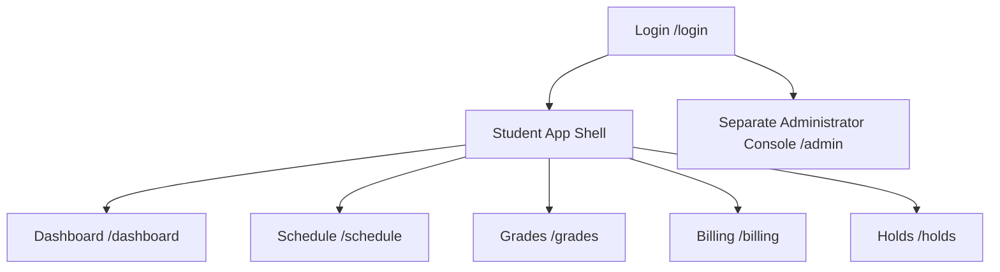

# Frighton University SIS — Page Architecture & Blueprint

## Scope and delivery status

Frighton SIS is a student self-service portal with a distinct administrator surface. The shared university `public.users` directory controls access; the SIS academic profile is `public.profiles`, keyed by `users_id` and identified externally by `student_number`.

- Only active `student` and `admin` directory accounts may sign in.
- The implemented dashboard endpoint is student-only: `GET /api/v1/dashboard/me`.
- The dashboard reads academic assignments from `academic_records`; this SIS does not model enrollment, registration, waitlists, section capacity, instructor accounts, or registrar accounts.
- The LMS integration is server-to-server and manages library-debt holds. Never place its API key in browser code.
- Dashboard, Schedule, Grades, and Billing have student-only read APIs. Their pages remain frontend work; Holds and the separate Admin surface remain roadmap items.

## Route map

## Student dashboard

- **Route**: `/dashboard`
- **Access**: Student only.
- **Backend**: `GET /api/v1/dashboard/me`, protected by `requireAuth` and `requireStudent`.
- **Data returned**:
  - Digital ID: name, `studentNumber`, program, department, year level, academic status, and avatar.
  - Active academic term.
  - Metrics: current academic credits, cumulative GPA, earned credits, and active hold count.
  - Billing: current-term total billed, completed payments, outstanding balance, account status, and due date.
  - Unresolved student holds.
  - Current-term classes scheduled on the current `Asia/Manila` weekday.

The dashboard must render assignment language such as “current academic credits”; it must not imply that it can register a student for a class.

## Roadmap views

| Route | Audience | Backing tables | Notes |
| --- | --- | --- | --- |
| `/schedule` | Student | `academic_records`, `course_sections`, `courses`, `academic_terms` | `GET /api/v1/schedule/me` is available; weekly and list views remain future UI work. |
| `/grades` | Student | `academic_records`, `course_sections`, `courses`, `academic_terms` | `GET /api/v1/grades/me` returns the static transcript and GPA; presentation remains future UI work. |
| `/billing` | Student | `student_accounts`, `student_payments`, `academic_terms` | `GET /api/v1/billing/me` returns the current balance and historical cashier-posted statements. It is not an online payment portal. |
| `/holds` | Student | `student_holds` | Library holds use `hold_type = 'library_debt'`. |
| `/admin` | Admin | Portal tables above | Separate from the student dashboard; it is not implemented by the student route. |

## UI shell

The future student shell should expose Dashboard, Schedule, Grades, Billing, and Holds. Show the active term and active-hold indicator. Use the `studentNumber` returned by the API; do not use the retired `frighton_id` name. Administrator navigation belongs to the separate admin surface.

## Billing view intent

The Billing page is a read-only statement center, not a payment gateway. The frontend should make the active-term statement prominent and use the returned `statements` as a newest-first term switcher or account history.

- Show total assessed, completed cashier payments, outstanding balance, due date, and `statementStatus` on the active-term card.
- Break charges into tuition, mandatory fees, and scholarship/discount. Show the receipt ledger with paid date, amount, reference number, and posting status.
- Display the supplied cashier and official-receipt notices near the ledger. A print action may create a reference statement, but must not label it an official receipt.
- Do not add a **Pay now** control, card/wallet forms, student-entered payments, or any payment write route. Only an authorized cashier/internal process records payments.
- If a future financial hold exists, cross-link it to `/holds`; do not infer or create a hold from a balance in the UI.

## Implementation order

1. Add the student authentication screen and a protected app shell.
2. Build `/dashboard` against the existing dashboard endpoint.
3. Build Schedule, Grades, and Billing views against their existing read APIs; add the Holds read API/view.
4. Build the separate admin API and console with explicit admin authorization.
5. Connect the LMS only from server-side code using `X-LMS-API-KEY`.
