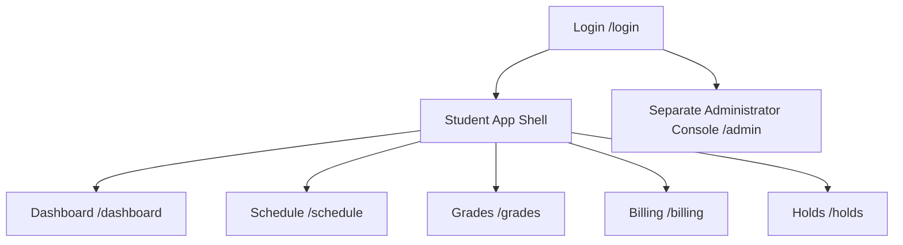

# Frighton University SIS — Page Architecture & Blueprint

## Scope and delivery status

Frighton SIS is a student self-service portal with a distinct administrator surface. The shared university `public.users` directory controls access; the SIS academic profile is `public.profiles`, keyed by `users_id` and identified externally by `student_number`.

- Only active `student` and `admin` directory accounts may sign in.
- The implemented dashboard endpoint is student-only: `GET /api/v1/dashboard/me`.
- The dashboard reads academic assignments from `academic_records`; this SIS does not model enrollment, registration, waitlists, section capacity, instructor accounts, or registrar accounts.
- The LMS integration is server-to-server and manages library-debt holds. Never place its API key in browser code.
- The other routes below are the UI/API roadmap, not existing backend routes.

## Route map

## Student dashboard

- **Route**: `/dashboard`
- **Access**: Student only.
- **Backend**: `GET /api/v1/dashboard/me`, protected by `requireAuth` and `requireStudent`.
- **Data returned**:
  - Digital ID: name, `studentNumber`, program, department, year level, academic status, and avatar.
  - Active academic term.
  - Metrics: current academic credits, cumulative GPA, earned credits, and active hold count.
  - Billing: current-term total billed, completed payments, outstanding balance, account status, and due date.
  - Unresolved student holds.
  - Current-term classes scheduled on the current `Asia/Manila` weekday.

The dashboard must render assignment language such as “current academic credits”; it must not imply that it can register a student for a class.

## Roadmap views

| Route | Audience | Backing tables | Notes |
| --- | --- | --- | --- |
| `/schedule` | Student | `academic_records`, `course_sections`, `courses`, `academic_terms` | `GET /api/v1/schedule/me` is available; weekly and list views remain future UI work. |
| `/grades` | Student | `academic_records`, `course_sections`, `courses`, `academic_terms` | Transcript and GPA presentation are future UI/API work. |
| `/billing` | Student | `student_accounts`, `student_payments`, `academic_terms` | Do not add payment simulation without a protected write API. |
| `/holds` | Student | `student_holds` | Library holds use `hold_type = 'library_debt'`. |
| `/admin` | Admin | Portal tables above | Separate from the student dashboard; it is not implemented by the student route. |

## UI shell

The future student shell should expose Dashboard, Schedule, Grades, Billing, and Holds. Show the active term and active-hold indicator. Use the `studentNumber` returned by the API; do not use the retired `frighton_id` name. Administrator navigation belongs to the separate admin surface.

## Implementation order

1. Add the student authentication screen and a protected app shell.
2. Build `/dashboard` against the existing dashboard endpoint.
3. Add read APIs and views for schedule, transcript, billing, and holds.
4. Build the separate admin API and console with explicit admin authorization.
5. Connect the LMS only from server-side code using `X-LMS-API-KEY`.
