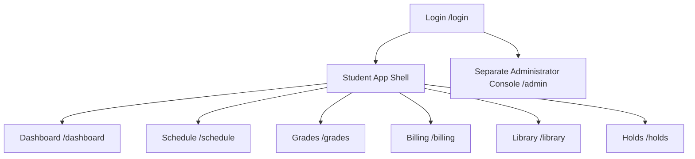

# Frighton University SIS - Page Architecture & Blueprint

## Scope and delivery status

Frighton SIS is a student self-service portal with a distinct administrator surface. The shared university `public.users` directory controls access; the SIS academic profile is `public.profiles`, keyed by `users_id` and identified externally by `student_number`.

- Only active `student` and `admin` directory accounts may sign in.
- The implemented dashboard endpoint is student-only: `GET /api/v1/dashboard/me`.
- The dashboard reads academic assignments from `academic_records`; this SIS does not model enrollment, registration, waitlists, section capacity, instructor accounts, or registrar accounts.
- The React client implements sign-in, session restoration, browser navigation, and a protected student shell. Dashboard, Schedule, Grades, and Billing are available student pages; Stage 1 adds the Holds page and a Library landing page.
- SIS owns student identity, borrowing eligibility, and university holds. The Library Management System (LMS) owns its catalog, reservations, loans, due dates, and fines.
- The student browser calls SIS APIs only. SIS and LMS communicate server-to-server with separate credentials; LMS API keys and service-role capabilities never enter browser code.
- Dashboard, Schedule, Grades, Billing, and Holds have student-only read APIs. The Library landing page is available while its LMS-backed features remain pending. The administrator surface remains separate.

## Route map

## Student dashboard

- **Route**: `/dashboard`
- **Access**: Student only.
- **Backend**: `GET /api/v1/dashboard/me`, protected by `requireAuth` and `requireStudent`.
- **Data returned**:
  - Digital ID: name, `studentNumber`, program, department, year level, academic status, and avatar.
  - Active academic term.
  - Metrics: current academic credits, cumulative GPA, earned credits, and active hold count.
  - Billing: current-term total billed, completed payments, outstanding balance, account status, and due date.
  - Unresolved student holds.
  - Current-term classes scheduled on the current `Asia/Manila` weekday.

The dashboard must render assignment language such as "current academic credits"; it must not imply that it can register a student for a class.

## Roadmap views

| Route | Audience | Backing system/tables | Notes |
| --- | --- | --- | --- |
| `/schedule` | Student | `academic_records`, `course_sections`, `courses`, `academic_terms` | `GET /api/v1/schedule/me` is available; weekly and list views remain future UI work. |
| `/grades` | Student | `academic_records`, `course_sections`, `courses`, `academic_terms` | `GET /api/v1/grades/me` returns the static transcript and GPA; presentation remains future UI work. |
| `/billing` | Student | `student_accounts`, `student_payments`, `academic_terms` | `GET /api/v1/billing/me` returns the current balance and historical cashier-posted statements. It is not an online payment portal. |
| `/library` | Student | LMS `books`, `reservations`, `borrow_records` | Stage 1 shows an integration-pending landing page. Stage 2 adds catalog, reservation, loan, due-date, and read-only fine data. |
| `/holds` | Student | SIS `student_holds` | `GET /api/v1/holds/me` and the read-only account-restrictions page are implemented. Library restrictions use `hold_type = 'library_debt'`. |
| `/admin` | Admin | SIS portal tables | Separate from the student dashboard; it is not implemented by a student route. |

## UI shell

The protected student shell exposes Dashboard, Schedule, Grades, Billing, Library, and Holds. It supports browser back/forward navigation and shows the active term and active-hold indicator. Use the `studentNumber` returned by the API; do not use the retired `frighton_id` name. Administrator navigation belongs to the separate admin surface: an administrator who signs in here sees an explicit handoff rather than a student shell.

## Library view intent

The Library page is a student self-service view of LMS-owned data. It is not a librarian console and it does not give the browser direct database or LMS access. Stage 1 deliberately renders an integration-pending landing page; it does not show synthetic catalog data or enabled reservation/cancellation controls.

- Stage 2 will show a searchable catalog with availability and a Reserve action for available copies.
- A v1 reservation is a Main Library pickup reservation, not a waitlist. An active reservation is ready for pickup, expires after three days, and can be cancelled by the student before fulfilment.
- Show the student's active reservations, including book details, status, reservation date, Main Library pickup location, and expiry date.
- Show current loans with Manila-local due dates, overdue days, and read-only unpaid fines.
- Do not add renewals, loan history, student-entered payments, card/wallet forms, or librarian/staff workflows in v1.
- The LMS must allocate an available copy atomically, expire stale reservations, fulfil a reservation into a loan, and prevent duplicate active reservations for the same student and book.

## Holds view intent

The Holds page is a read-only account-restrictions view, not a library-loan or reservation page.

- Show active restrictions first, followed by resolved-hold history.
- For each hold, show its type, reason, source, placement date, status, and clearance guidance.
- A `library_debt` hold is an SIS restriction caused by library debt; it is not itself a book reservation or a loan record.
- Cross-link library-related guidance to `/library` and financial-hold guidance to `/billing` where appropriate.
- Students cannot create, edit, pay, or resolve holds from this page. Authorized SIS processes and the LMS manage hold state.

## Student APIs and LMS integration

Every student API requires `requireAuth` plus `requireStudent` and derives the student from the authenticated SIS session; the browser must never submit a student identifier or an LMS credential. The Holds endpoint is implemented in Stage 1. Library gateway APIs are planned for Stage 2 only, after the separate LMS publishes its service contract.

| Planned SIS API | Purpose |
| --- | --- |
| `GET /api/v1/library/books` | Return LMS-backed catalog search and availability data. |
| `GET /api/v1/library/me` | Return the signed-in student's active reservations, current loans, due dates, and read-only unpaid fines. |
| `POST /api/v1/library/reservations` | Request a reservation for an available LMS book using a server-derived student identity. |
| `DELETE /api/v1/library/reservations/:reservationId` | Cancel the signed-in student's eligible active reservation. |
| `GET /api/v1/holds/me` | **Implemented.** Return the signed-in student's active holds and resolved-hold history. |

SIS checks active status and unresolved SIS holds before forwarding a reservation request to LMS. LMS remains authoritative for availability, reservation state, loans, due dates, and fine amounts. If LMS is unavailable, SIS must not create or change a reservation locally.

When the Stage 2 contract is available, SIS configuration will add an LMS base URL and a distinct SIS-to-LMS credential. The existing LMS-to-SIS integration credential remains inbound-only. Both credentials stay server-side and are never exposed to the student browser.

LMS continues to call the protected SIS integration endpoints to check a student's borrowing eligibility and synchronize library debt holds. Use `studentNumber` consistently in every new contract; `frighton_id` is legacy terminology and must not be reintroduced.

The Stage 2 LMS contract must create or update an idempotent SIS `library_debt` hold when a loan is 14 days overdue or an unpaid replacement charge exists. It must resolve that hold only when all qualifying library debt has been cleared; this synchronization upgrade is not part of the Stage 1 SIS portal release.

## Billing view intent

The Billing page is a read-only statement center, not a payment gateway. The frontend should make the active-term statement prominent and use the returned `statements` as a newest-first term switcher or account history.

- Show total assessed, completed cashier payments, outstanding balance, due date, and `statementStatus` on the active-term card.
- Break charges into tuition, mandatory fees, and scholarship/discount. Show the receipt ledger with paid date, amount, reference number, and posting status.
- Display the supplied cashier and official-receipt notices near the ledger. A print action may create a reference statement, but must not label it an official receipt.
- Do not add a **Pay now** control, card/wallet forms, student-entered payments, or any payment write route. Only an authorized cashier/internal process records payments.
- If a future financial hold exists, cross-link it to `/holds`; do not infer or create a hold from a balance in the UI.

## Implementation order

1. Complete the protected student shell, including the Library and Holds navigation and administrator handoff.
2. Define and implement the separate LMS server-to-server API/client contract with distinct directional credentials.
3. Replace the Library pending state with catalog search, available-copy pickup reservation, active reservations, current loans, and read-only unpaid fines.
4. Implement the Holds read API and `/holds` view, including active restrictions and resolved history.
5. Complete remaining student pages against their existing student-only APIs.
6. Build the separate admin API and console with explicit admin authorization.

Steps 1 and 4 are the completed Stage 1 baseline. Steps 2 and 3 require the separate LMS repository and test environment; they are not implemented in the SIS while its service contract is unavailable.

## Explicit boundaries

This baseline excludes academic enrollment and registration, course waitlists, librarian UI, loan renewals, online payment processing, and direct browser access to LMS credentials, service-role keys, or LMS-owned write operations.
