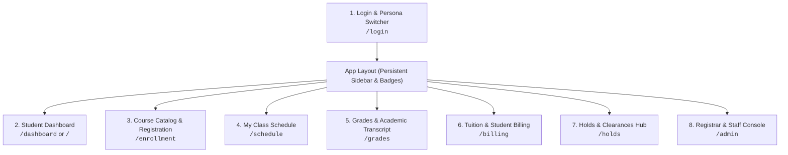

# Frighton University SIS — Page Architecture & Blueprint

## 1. Executive Summary & Design Scope

The **Frighton University Student Information System (SIS)** architecture is designed to strike an ideal balance: **rich, authentic, and functional without being an over-engineered enterprise monolith**. 

- **Primary Persona**: Undergraduate Student Portal (clean, self-service, modern dark academia aesthetic).
- **Secondary Persona**: Academic Registrar / Staff Console (quick directory, hold management, and course oversight).
- **Billing & Grades Logic**:
  - Demo accounts receive pre-seeded grades, course histories, and active hold scenarios.
  - Newly created student accounts calculate tuition balances dynamically using a **deterministic constant fee schedule** based on their Year Level and Academic Term.
- **Integration**: Direct coupling with the **Frighton Library Management System (LMS)** to display and enforce library holds (`library_debt`) during course registration and clearance.

---

## 2. Page & Route Map

---

## 3. Detailed Page Specifications

### Page 1: Authentication & Quick-Login (`/login`)
- **Route**: `/login`
- **Access**: Public / Unauthenticated
- **Purpose**: Authenticate students, faculty, and administrative staff.
- **Key UI Elements**:
  - Gothic-modern university crest and branded login card.
  - Email & password sign-in (Supabase Auth).
  - **1-Click Persona Switcher (Development & Demo Presets)**:
    - *Student (1st Year Freshman - Clean Standing)*
    - *Student (3rd Year Junior - Active Library & Financial Holds)*
    - *Academic Registrar / Administrator*
  - **New Student Registration Form**:
    - Input: First name, Last name, Email, Department/Major, Starting Year (1st–4th Year).
    - Auto-generates `frighton_id` (e.g. `STU-2026-XXXX`).
    - Auto-assigns the initial tuition balance according to the **Tuition Constant Matrix**.

---

### Page 2: Student Dashboard (`/` or `/dashboard`)
- **Route**: `/dashboard`
- **Access**: Student, Instructor, Admin
- **Purpose**: High-level personal summary, daily schedule, and urgent academic notices.
- **Key UI Elements**:
  - **Student Digital ID Badge**: Avatar, Name, `frighton_id`, Program/Major, Year Level, Academic Status (`Active` / `Probation`).
  - **Urgent Notification Banner**: Displays if active holds exist (e.g., *"⚠️ Active Library Hold: $45 Overdue Rare Manuscript Fine. Registration is restricted."*).
  - **Metric Stat Cards**:
    - Current Enrolled Credits (e.g., `15 Units`).
    - Cumulative GPA (e.g., `3.74`).
    - Outstanding Balance (e.g., `$4,850 Due`).
    - Active Holds Count (`1 Active`).
  - **Today's Class Agenda**: Timeline of courses scheduled for the current day with room numbers, times, and instructor names.
  - **Quick Action Links**: *Register for Classes*, *View Transcript*, *Pay Tuition*, *Clear Holds*.

---

### Page 4: My Class Schedule (`/schedule`)
- **Route**: `/schedule`
- **Access**: Student, Instructor
- **Purpose**: Clear visualization of weekly class commitments.
- **Key UI Elements**:
  - **View Switcher**:
    1. **Weekly Timetable Grid**: 5-day visual schedule (Mon–Fri, 8:00 AM – 6:00 PM) with colored course blocks to easily detect time conflicts.
    2. **Structured List View**: Detailed list format including building location, office hours, and professor contact email.
  - **Export Option**: "Download Schedule (PDF/ICS)" or print-friendly layout.

---

### Page 5: Grades & Academic Transcript (`/grades`)
- **Route**: `/grades`
- **Access**: Student, Registrar
- **Purpose**: Historical academic records, term performance, and GPA computation.
- **Key UI Elements**:
  - **Academic Standing Card**:
    - Cumulative GPA (4.0 Scale).
    - Total Credits Earned toward Degree (e.g. `45 / 120 Units`).
    - Academic Honors status (Dean's List eligibility).
  - **Term-by-Term Accordion**:
    - Historical semesters with courses taken, credit weight, and final letter grades (`A`, `B+`, `A-`, etc.).
    - In-progress semester showing enrolled courses with `In Progress (IP)` status and midterm evaluations.
  - **Graduation Progress Bar**: Visual progress tracker toward required department credits.

---

### Page 6: Tuition & Student Billing (`/billing`)
- **Route**: `/billing`
- **Access**: Student, Registrar
- **Purpose**: Transparent account ledger, tuition breakdown based on constants, and payment simulation.
- **Tuition Constant Matrix (Determined by Year & Term)**:
  | Year Level | Term | Base Tuition | Mandatory Fees (Tech, Lab, Library) | Total Balance |
  | :--- | :--- | :--- | :--- | :--- |
  | **1st Year (Freshman)** | Fall / Spring | $4,500 | $350 | **$4,850** |
  | **2nd Year (Sophomore)**| Fall / Spring | $4,800 | $250 | **$5,050** |
  | **3rd Year (Junior)**   | Fall / Spring | $5,100 | $300 | **$5,400** |
  | **4th Year (Senior)**   | Fall / Spring | $5,400 | $400 (Graduation & Audit) | **$5,800** |
- **Key UI Elements**:
  - **Account Summary Card**: Total Billed, Total Paid, Net Balance Outstanding.
  - **Itemized Fee Breakdown**: Tuition Fee + Laboratory Fee + Technology Access Fee - Scholarships/Payments.
  - **Simulate Payment Modal**: Enter an amount (or "Pay in Full") to simulate payment processing, which decrements the balance and automatically resolves any financial holds.
  - **Payment Receipt History**: Table of simulated transactions with date, reference number, and receipt status.

---

### Page 7: Holds & Clearances Hub (`/holds`)
- **Route**: `/holds`
- **Access**: Student, Registrar
- **Purpose**: Centralized view of all administrative, financial, and library restrictions placed on the student.
- **Key UI Elements**:
  - **Direct LMS Integration Status**:
    - Displays holds originating from the **Library Management System** (`hold_type: 'library_debt'`).
    - Shows reason (e.g. *"Overdue Grimoire Vol. II"*), fine amount, and timestamp placed by `Frighton LMS`.
  - **Internal SIS Holds**:
    - Academic probation holds.
    - Financial delinquency holds.
  - **Hold Status Badge**: `ACTIVE (Restricting Registration)` or `RESOLVED (Cleared)`.
  - **Resolution Instructions**: Clear guidance on how to clear each hold (e.g. *"Visit Frighton Central Library Desk or resolve via LMS Portal"*).

---

### Page 8: Registrar & Staff Console (`/admin`)
- **Route**: `/admin`
- **Access**: Registrar, Admin, Staff
- **Purpose**: Unified control center for university operations without overwhelming the student-facing view.
- **Key UI Elements**:
  - **Student Directory Table**:
    - Searchable list of all students with ID, Name, Department, Year Level, Net Balance, and Active Holds.
  - **Hold Manager**:
    - Ability to manually place a hold or resolve an existing hold.
    - Live feed of holds synchronized from the LMS Integration Bridge.
  - **Course Enrollment Monitor**:
    - Class capacity overview: view sections that are full, open, or waitlisted.

---

## 4. UI Shell & Navigation System

- **Persistent Sidebar Navigation**:
  - Always visible on desktop; collapsible drawer on mobile.
  - Icons from `lucide-react`:
    - Dashboard: `LayoutDashboard`
    - Registration: `BookOpen`
    - Schedule: `Calendar`
    - Grades: `GraduationCap`
    - Billing: `CreditCard`
    - Holds: `ShieldAlert` (features red warning dot when active holds exist)
    - Admin Console: `Settings` (visible only for admin/registrar roles)
- **Top Utility Bar**:
  - Current Academic Term indicator (e.g. `Fall Semester 2026`).
  - Active Student Profile pill with quick role toggle.
  - Notification icon.

---

## 5. Implementation Sequence

1. **Step 1 — Router Setup**: Configure React Router DOM in `client/` with routes for all 8 views wrapped in a responsive AppShell layout.
2. **Step 2 — Constants & Mock Store**: Define the Tuition Constant Matrix, mock student profiles, and local state helpers for seamless offline/online operation.
3. **Step 3 — Core Student Views**: Build Dashboard, Course Enrollment, Schedule, Grades, and Billing pages with rich dark theme aesthetics.
4. **Step 4 — Holds & LMS Bridge UI**: Connect the Holds view to the existing `/api/v1/integration/` endpoints.
5. **Step 5 — Admin View & Quick Persona Switcher**: Finalize the role switching header and Registrar table.
